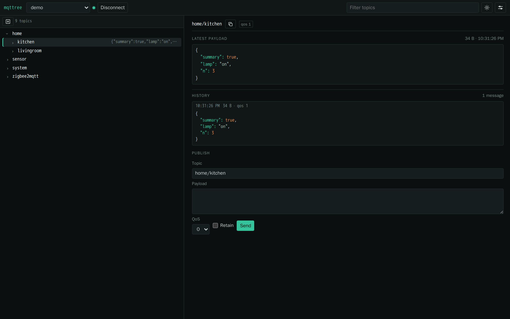

# mqttree

Self-hosted MQTT topic browser: subscribe to a broker, keep the topic tree and
message history in SQLite, and inspect it from a phone.



## Why

The web-based MQTT explorers that do the one thing that matters — show the whole
broker as a tree instead of a subscription list — are either unmaintained or
one-person projects with no retention story. mqttree is one Go binary, one
SQLite file and one HTTP port.

## Features

- **Topic tree** — subscribes to a filter (`#` by default), shows every topic as
  a collapsible tree with its last value, retained marker and activity highlight.
- **History** — every message is stored per topic and pages back in the detail
  view. JSON payloads are pretty-printed and syntax highlighted, binary payloads
  are shown as base64.
- **Retention** — per-message expiry from MQTT v5, otherwise a configurable
  retention window, plus a database size cap that prunes oldest first.
- **Saved connections** — multiple brokers, TLS with a custom CA, username and
  password. Passwords are sealed with XChaCha20-Poly1305 using a key file that is
  separate from the database.
- **Publish** — send a message to any topic with QoS and retain.
- **Layout** — resizable tree, dark/light theme, compact mobile view.

## Quick start

Docker:

```sh
docker build -t mqttree:1.0.0 .
docker run -d --name mqttree \
  -p 127.0.0.1:8080:8080 \
  -v mqttree-data:/data \
  mqttree:1.0.0
```

Binary: download the archive for your platform from the release page and run it.

```sh
tar xzf mqttree_1.0.0_linux_amd64.tar.gz
./mqttree -version
./mqttree
```

From source (Go 1.24+):

```sh
go build -trimpath -o mqttree .
./mqttree
```

Then open <http://127.0.0.1:8080>, open Settings and add a broker connection.

## Configuration

| Variable | Default | Purpose |
| --- | --- | --- |
| `MQTTREE_LISTEN` | `127.0.0.1:8080` | HTTP listen address. Binding a non-loopback address logs a warning because the API has no authentication. |
| `MQTTREE_DATA_DIR` | `/var/lib/mqttree` | SQLite database directory. |
| `MQTTREE_SECRET_KEY_FILE` | `/etc/mqttree/secret.key` | 32-byte key sealing broker passwords. Generated on first start if absent. |
| `MQTTREE_LOG_LEVEL` | `info` | `debug`, `info`, `warn`, `error`. |

The Docker image listens on `:8080` inside the container and keeps both the
database and the key under `/data`; publish the port on loopback.

## Security model

- **No built-in authentication.** mqttree is designed to sit behind an
  authenticating reverse proxy (forward-auth, basic auth, VPN). The API can
  publish messages, so exposing it directly gives anyone on the network broker
  write access. The default listen address is loopback for this reason.
- **Credentials at rest** are encrypted with a key file read from
  `MQTTREE_SECRET_KEY_FILE`. The database alone does not disclose broker
  passwords; copy the key with the database or re-enter the passwords.
- **No telemetry**, no external assets, no outbound connections except to the
  brokers you configure.
- Payloads are escaped before rendering; the UI ships a strict Content Security
  Policy without inline scripts or styles.

See [SECURITY.md](SECURITY.md) for reporting.

## Storage behaviour

Messages are pruned every five minutes:

1. messages past their MQTT v5 expiry interval,
2. messages older than `retention_hours` (default 24, editable in the UI),
3. oldest messages first while the database exceeds `max_db_bytes`
   (default 1 GiB).

Payloads larger than `max_payload_bytes` (default 256 KiB) are truncated and
flagged in the UI. `Clear stored messages` in Settings deletes the tree and
history for the selected connection and keeps the connection itself.

## API

`GET /api/bootstrap`, `GET|POST /api/connections`, `PUT|DELETE /api/connections/{id}`,
`POST /api/connections/{id}/start|stop|clear`, `GET /api/tree`,
`GET /api/messages`, `POST /api/publish`, `GET|PUT /api/settings`,
`GET /api/events` (websocket batches), `GET /healthz`.

## Limitations

- **MQTT v5 only.** Brokers that speak only v3.1.1 are not supported.
- **One shared session per connection.** Every browser talks to the same
  server-side subscription; this is a single-operator debugging tool, not a
  multi-tenant service.
- Broker-side WebSocket transports and client certificates are not implemented.

## Development

```sh
go test ./...
gofmt -l .
```

End-to-end (Playwright, needs Docker):

```sh
./e2e/run.sh
```

## License

Apache-2.0. See [LICENSE](LICENSE).
